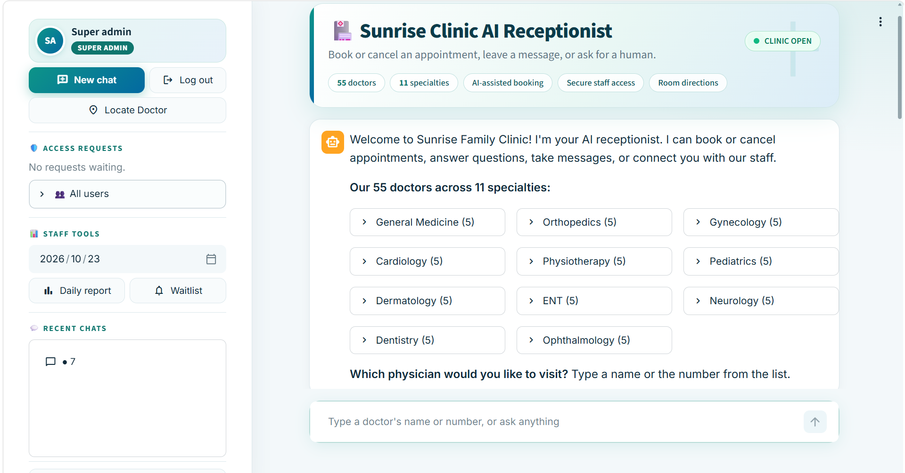

# ClinicPilot: AI Receptionist for Clinics



**One MCP server. Any agent. Books visits, guides patients to the room, and keeps staff access safe by design.**

ClinicPilot is an AI receptionist for a busy clinic (the demo uses a sample clinic, Sunrise Family Clinic). Patients talk to it in plain language and it books and cancels appointments, answers questions, takes messages, tells them how to find the doctor's room, and hands over to a human when needed. Staff get a secure web app with role-based access, daily reports and an observability log that shows where the AI fell short.

> Built for the Amazon Developer Hackathon, **Alexa+ category**: a working **self-hosted MCP server** (MCP spec version **2025-11-25**) plus a web app that simulates the Alexa+ experience with our own agent (Gemini).

**Demo video:** <https://youtu.be/T177kCqMVJs>

## Hackathon requirements

| Requirement | How ClinicPilot meets it |
|---|---|
| Self-hosted MCP server | `server/main.py` runs a FastMCP server over Streamable HTTP, hosted by you on your own machine |
| MCP spec version 2025-11-25 or newer | The server negotiates protocol version `2025-11-25` (Python MCP SDK 1.23 or newer) |
| Optional: simulate the Alexa+ experience in a web app | `web/app.py` is a chat web app where our own agent calls the MCP tools like an Alexa+ skill would |

To confirm the version yourself, start the server and run `python -c "import mcp.types as t; print(t.LATEST_PROTOCOL_VERSION)"`. It should print `2025-11-25`.

## Why this exists

Clinic front desks lose hours to the same calls: "Is Dr. Iyer free on Thursday?", "Cancel my slot", "Which floor is the dentist?" Calls get missed, patients no-show, and receptionists cannot be everywhere. This project answers those requests instantly, around the clock, and keeps every action inside clear rules so staff can trust it.

## What it does

**For patients**
- Chat to book or cancel an appointment with any of 55 doctors across 11 specialties.
- See a week of availability, or join a waitlist when a slot is full.
- Phone numbers are validated by country before anything is saved.
- Booking confirmation includes directions, for example "take the lift to the 3rd floor and follow the signboard with the doctor's name".
- A reminder email goes out one hour before the visit. The patient can reply YES or CANCEL, and a cancellation frees the slot for the waitlist.
- Emergencies, complaints and billing disputes are handed to a human.

**For staff**
- Sign-up with owner approval: a new receptionist creates an account, the owner (super admin) gets an alert, picks a role and approves, and the new user is emailed.
- Roles enforced on the server, not just in the interface:

| Role | Can do |
|---|---|
| Viewer | Look things up only |
| Editor | Look up, add and update |
| Admin | Everything except delete |
| Super admin | Everything, including delete and approvals |

- **Locate Doctor** button: pick a doctor and see how to reach their room.
- **Recent chats** list in the sidebar, so a conversation can be reopened.
- **Observability Logs** (super admin): every reply that errored, hit a failed tool, could not answer, or needed a human, with a filter, a resolved flag and CSV download. It shows the product owner what to improve next.
- Daily report, waitlist notifications, and per-doctor reports exportable to CSV or Excel (staff PIN required).

## How it is built

```
Streamlit web app  ->  Gemini agent  ->  MCP server (FastMCP, Streamable HTTP)  ->  SQLite
   (web/app.py)       (agent/*.py)        (server/main.py behind AuthGuard)
```

- **MCP server** (`server/main.py`): every clinic action is a tool (book, cancel, directions, reports, messages, and so on). An ASGI guard (`server/guard.py`) checks the session token and the caller's role against `server/permissions.py` before any tool runs.
- **Agent** (`agent/agent.py`, `agent/tools.py`): Google Gemini with function calling. It only sees the tools its user's role is allowed to use, and it explains refusals in plain words.
- **Web app** (`web/app.py`): login, sign-up and approval, chat, Locate Doctor, Documentation, staff tools and the observability window. Chat history and logs live in `web/chatstore.py`.
- **Security:** scrypt-hashed passwords, hashed session tokens that expire after 8 hours, lockout after 5 wrong logins, and the role is re-checked from the database on every click.
- **Reminders** (`server/reminders.py`): a small worker that sends the reminder emails and processes YES or CANCEL replies.

## Run it locally

Requirements: Python 3.11 or newer and a Gemini API key.

```bash
git clone https://github.com/praveendataguy/clinic-pilot.git
cd clinic-pilot
python -m venv .venv
# Windows:  .venv\Scripts\activate        macOS/Linux:  source .venv/bin/activate
pip install -r requirements.txt
cp .env.example .env        # Windows: copy .env.example .env
```

Fill in `.env`:

| Variable | Meaning |
|---|---|
| `GEMINI_API_KEY` | Your Gemini API key |
| `GEMINI_MODEL` | Model name, for example `gemini-3.5-flash-lite` |
| `MCP_SERVER_URL` | `http://127.0.0.1:8000/mcp` |
| `STAFF_PIN` | PIN for doctor reports and exports |
| `SUPER_ADMIN_EMAIL` / `SUPER_ADMIN_PASSWORD` | The owner account, created on first start |
| `APP_URL` | `http://localhost:8501` |
| `MAIL_USER` / `MAIL_PASSWORD` | Gmail address and App Password. Optional: without them, emails are printed in the terminal (dry run) |

Start three terminals, with the virtual environment active in each:

```bash
python server/main.py          # 1. MCP server on port 8000
python server/reminders.py     # 2. reminder worker (optional)
streamlit run web/app.py       # 3. web app on http://localhost:8501
python -m tests.try_server     # 4. To check the server on its own
```

Log in with the super admin email and password from `.env`. To try the approval flow, open a private window, create an account, then approve it from the sidebar.

A terminal version of the agent is also available: `python agent/agent.py`.

## Project layout

```
agent/      Gemini agent and MCP client helpers
server/     MCP server, auth, permissions, mailer, reminders, doctor data
web/        Streamlit app, chat history store, in-app documentation
skills/     Assistant skill definition
tests/      Server smoke test
.streamlit/ Theme
```

## Limits (honest list)

- Runs on one machine with SQLite. For several clinics you would move to a hosted database.
- Emails need a Gmail App Password (or another SMTP service) to actually send.
- The observability flags use simple rules, so a confident but wrong answer can slip through.
- Opened conversations continue from their text. The earlier tool calls are not replayed.

## License

See `LICENSE`.